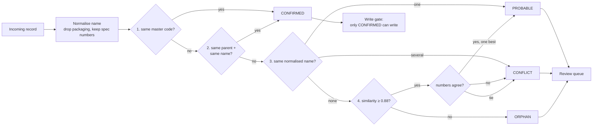

# entity-matcher

**Deterministic product matching across systems — with a write gate that only lets confirmed matches change data.**

Every system in a company names the same product a little differently:

| Online store | Supplier price list | Marketplace feed |
|---|---|---|
| `Laptop Charger 65W USB-C - box of 10` | `laptop charger 65 W usb-c (pack 20)` | `CARREGADOR NOTEBOOK 65W USB-C` |

Before you can sync costs, prices or stock between them, you have to answer *"is this the same product?"* — and a wrong answer silently corrupts data. This library answers that question **without a language model in the identity path**: the same input always produces the same result, and every result says which rule produced it and why.

```
$ python -m entity_matcher examples/catalogue.csv examples/incoming.csv

store:S-17        Laptop Charger 65W USB-C - box of 10  confirmed P-001    stage=1  same master code
supplier:R-204    laptop charger 65 W usb-c (pack 20)   confirmed P-001    stage=2  same parent product and normalised name
marketplace:I-88  SSD NVME 1TB - BULK                   probable  P-006    stage=3  identical normalised name
store:S-31        Memory DDR4 32 GB 3200 MHz            probable  P-005    stage=3  identical normalised name
supplier:R-77     Memmory DDR4 16GB 3200MHz             probable  P-004    stage=4  similar name, numbers agree
marketplace:I-90  Memory DDR4 8GB 3200MHz               conflict  -        stage=4  numeric guard: ('3200', '4', '8') != ('16', '3200', '4') (P-004)
store:S-44        Monitor 23,8in Full HD                probable  P-003    stage=3  identical normalised name
supplier:R-12     Laptop Charger 45W USB-C              conflict  -        stage=4  numeric guard: ('45',) != ('65',) (P-001)
store:S-50        Mechanical Keyboard                   orphan    -        stage=-  no candidate above threshold

summary: {'confirmed': 2, 'probable': 4, 'conflict': 2, 'orphan': 1}
```

## How it works



| State | Meaning | Can it change data? |
|---|---|---|
| `confirmed` | Proven by a code or by parent + name | **Yes**, through the write gate |
| `probable` | Very likely, not proven | No — goes to human review |
| `conflict` | Looks alike but numbers differ, or ambiguous | No — goes to human review |
| `orphan` | Nothing close in the catalogue | No — candidate for a new product |

## Design decisions

**1. No model in the identity path.**
A fuzzy or AI matcher is right most of the time — and when it is wrong, it is wrong silently. Identity is the one place where "most of the time" is not good enough, so every rule here is deterministic, explainable and covered by tests. AI can still *suggest* matches for the review queue; it just can't *decide* one.

**2. Spec numbers are identity, packaging is not.**
`Memory DDR4 16GB` and `Memory DDR4 32GB` are almost identical as strings and are different products. `Laptop Charger 65W - box of 10` and `... (pack 20)` look different and are the same product. So packaging words and quantities are stripped before comparing, and the remaining numbers must match **exactly** (the *numeric guard*).

**3. Uncertainty can't become a write — enforced in code, not in a policy document.**
`Executor.apply()` only writes `confirmed` matches; anything else raises `NotWritable` or goes to the review queue. Dry-run is the default, writes are idempotent (same proposal twice = one write), and every write records `before`, `after` and who proposed it.

**4. Ambiguity is a conflict, not a coin toss.**
If two catalogue items are equally good candidates, the matcher refuses to pick one.

## Usage

```python
from entity_matcher import Canonical, Record, Matcher, Proposal, Executor

matcher = Matcher([
    Canonical("P-001", "Laptop Charger 65W USB-C", master_code="MC-1001", parent="LAPTOP CHARGER"),
    Canonical("P-004", "Memory DDR4 16GB 3200MHz"),
])

m = matcher.match(Record("supplier", "R-204", "laptop charger 65 W usb-c (pack 20)", parent="LAPTOP CHARGER"))
m.state       # MatchState.CONFIRMED
m.stage       # 2
m.reason      # 'same parent product and normalised name'

# A cost agent (human or AI) proposes a change; the executor decides if it may land.
target = {}
executor = Executor(target, dry_run=False)
outcome = executor.apply([Proposal(m, "cost", 12.50, proposed_by="cost-agent")])
target        # {'P-001': {'cost': 12.5}}
executor.audit[-1]  # {'before': None, 'after': 12.5, 'proposed_by': 'cost-agent', ...}
```

## Run it

```bash
pip install -e ".[dev]"
pytest                                   # 68 tests, including doctests
python -m entity_matcher examples/catalogue.csv examples/incoming.csv
python -m entity_matcher examples/catalogue.csv examples/incoming.csv --json
```

No runtime dependencies — standard library only (Python 3.10+).

## Project layout

```
src/entity_matcher/
  normalize.py   name normalisation and spec-number extraction
  matcher.py     the four stages, the guards, the result model
  gate.py        write gate, proposals, idempotent executor with audit trail
  __main__.py    CLI over two CSV files
tests/           68 tests: stages, guards, determinism, write gate
examples/        sample catalogue and incoming records (synthetic data)
```

## Context

A generic, clean-room implementation of a pattern for keeping product identity consistent across several systems before any automated process (a sync job, a pricing rule or an AI agent) is allowed to change data. All names and data here are synthetic.

MIT licensed.
